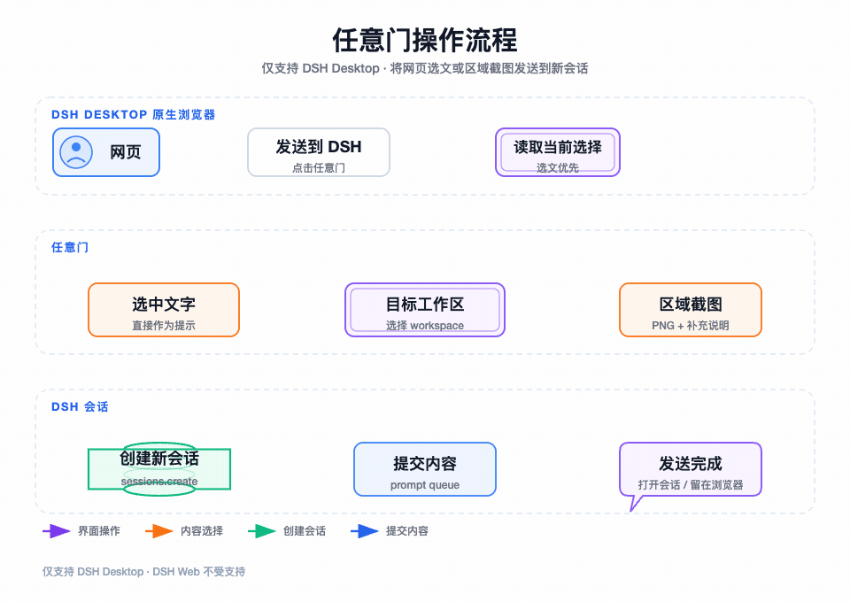

# DSH Browser

为 DeepSeek Harness（DSH）Desktop 提供一个全局、多标签、可持久化的浏览器面板。它使用桌面端原生 WebView 导航，并可通过“任意门”把网页选文或局部截图直接发送到指定 DSH 工作区的新会话。

> [!IMPORTANT]
> **本插件仅支持 DSH Desktop，不支持 DSH Web。** 浏览器导航、网页选文和区域截图依赖 Desktop 提供的 `dshDesktop` 原生桥接；在 `dsh web` 或普通浏览器环境中不属于受支持的使用方式。

## 平台要求

- DSH Desktop，且原生桥接协议 `dshDesktop.protocolVersion` 为 `1`
- 一个供 DSH Desktop 使用的 profile；下文以 `<desktop-profile>` 表示
- DSH Web、`dsh web` 和普通浏览器页面不受支持

## 功能

- 最多保留 20 个浏览器标签，标签、顺序和当前页面会持久化保存
- 标签拖动排序，侧栏支持收起和调整宽度
- 后退、前进、刷新、主页、地址栏和页内查找
- 在 DSH Desktop 中使用原生 WebView 浏览和导航
- “任意门”支持发送网页选文，或框选网页区域并发送 PNG 截图
- 任意门发送后可自动打开新会话，也可以留在浏览器中
- 中英文界面和可配置快捷键

## 任意门演示

“任意门”对应浏览器标签栏顶部的“发送到 DSH”按钮，仅在 DSH Desktop 的原生浏览器模式中可用。

动画的可缩放静态源文件见 [docs/portal-demo.svg](./docs/portal-demo.svg)。

### 发送网页选文

1. 在网页中选中一段文字，例如一段报错信息或文档内容。
2. 点击标签栏顶部的“发送到 DSH”按钮。
3. 在弹窗中选择目标工作区；选中的文字会自动填入“发送内容”。
4. 点击“发送”。插件会在该工作区创建新会话，并把文字作为第一条提示提交。
5. 默认会自动打开新会话；可在浏览器设置中改为发送后留在当前页面。

### 发送局部截图

1. 保持网页中没有文字选区，然后点击“发送到 DSH”。
2. 在网页上拖动鼠标，框选需要分析的区域。
3. 检查截图预览，选择目标工作区，并按需填写补充说明，例如“分析这个报错并给出修复步骤”。
4. 点击“发送”。插件会将 PNG 截图和补充说明提交到新会话。

> 任意门会把所选内容发送到你指定的工作区。发送包含账号、客户或内部系统信息的页面前，请先确认内容适合进入对应会话。

## 安装

### 从 GitHub 安装

将 `<desktop-profile>` 替换成 DSH Desktop 实际使用的 profile。以下命令固定安装 `v0.1.1`：

~~~bash
dsh plugin --profile <desktop-profile> add github:chenglun17-0/dsh-browser#v0.1.1
~~~

检查配置层并启动：

~~~bash
dsh --profile <desktop-profile> --dump-config
dsh --profile <desktop-profile>
~~~

移除插件：

~~~bash
dsh plugin --profile <desktop-profile> remove @chenglun17-0/dsh-browser
~~~

### 从本地源码安装

~~~bash
git clone https://github.com/chenglun17-0/dsh-browser.git
cd dsh-browser
npm ci
npm run build
dsh plugin --profile <desktop-profile> add .
~~~

## 配置

插件提供两个配置项：

| 配置项 | 默认值 | 说明 |
| --- | --- | --- |
| `defaultUrl` | `https://www.google.com/` | 新标签、主页按钮和 `Primary+T` 打开的 HTTP(S) 地址 |
| `afterSendBehavior` | `open-session` | 任意门发送后打开新会话；设为 `stay-browser` 时留在浏览器 |

可以在浏览器工具栏的设置入口修改这两个配置。地址只接受 HTTP 或 HTTPS，且不能包含用户名或密码。

## 快捷键

`Primary` 在 macOS 上是 Command，在 Windows/Linux 上是 Ctrl。快捷键只在浏览器面板处于活动状态时接管。

| 快捷键 | 操作 |
| --- | --- |
| `Primary+1` ... `Primary+9` | 切换到第 1 ... 9 个标签 |
| `Primary+T` | 新建标签 |
| `Primary+Shift+W` | 关闭当前标签 |
| `Primary+Shift+R` | 刷新当前标签 |
| `Primary+F` | 在当前页面中查找 |

## 运行环境与限制

- 仅支持 DSH Desktop；不支持 DSH Web、`dsh web` 或普通浏览器环境。
- 浏览器导航、网页选文和区域截图均依赖 Desktop 原生桥接；桥接不可用时不提供兼容性保证。
- 部分网站可能因登录策略、自动化检测或 Chromium WebView 兼容性限制而无法正常使用。
- 标签状态保存在当前 DSH Desktop 前端的本地存储中，不会在不同设备间自动同步。

## 开发

~~~bash
npm ci
npm run build
npm pack --dry-run
~~~

源码入口是 `src/client.jsx`，构建产物是 `client.js`。GitHub 安装不会自动运行 `build` 脚本，因此修改前端源码后必须重新构建，并将更新后的 `client.js` 一并提交。

## 第三方许可

项目代码使用 [MIT License](./LICENSE)。第三方组件许可见 [THIRD_PARTY_NOTICES.md](./THIRD_PARTY_NOTICES.md)。
